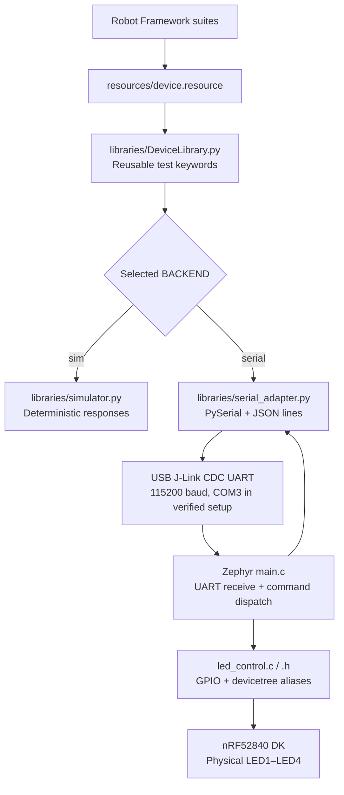
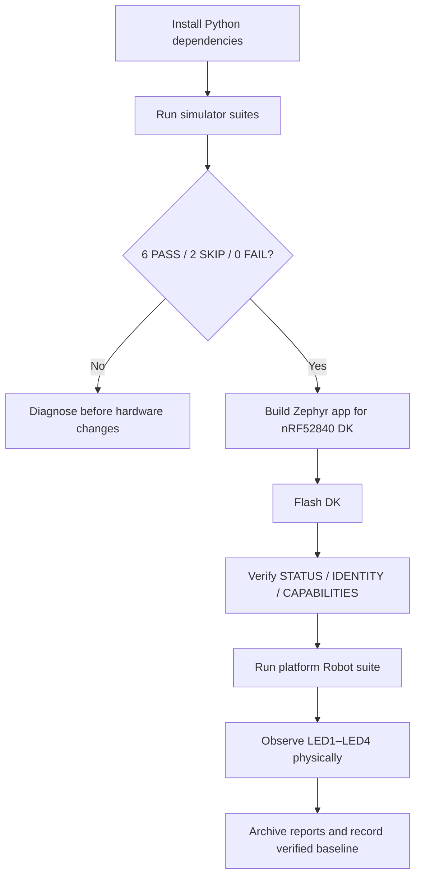
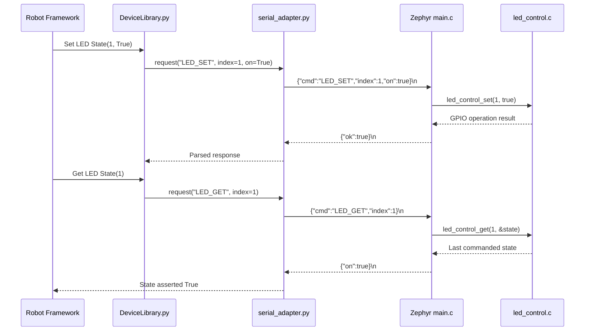

# Embedded HIL Automation

**Python + Robot Framework + embedded development kits | Reproducible simulation and physical hardware-in-the-loop testing**

> **Phase 1 status (verified 10 November 2026):** The refactored project passed its simulator regression (**8 tests: 6 PASS, 0 FAIL, 2 expected SKIP**), built and flashed successfully on a **Nordic nRF52840 DK**, returned valid UART protocol responses identifying **`hil-serial-v2`** and **four LEDs**, and passed the physical Robot Framework suite (**2 PASS, 0 FAIL**). The operator also confirmed the physical LED1–LED4 on/off sequence. **nRF54L15 DK, Silicon Labs EFR32BG22, physical buttons, and hardware BLE have not been validated.**

## Contents

- [Purpose and learning outcomes](#purpose-and-learning-outcomes)
- [Architecture](#architecture)
- [What has been verified](#what-has-been-verified)
- [Repository layout](#repository-layout)
- [Prerequisites](#prerequisites)
- [Tool requirements: mandatory vs optional](#tool-requirements-mandatory-vs-optional)
- [Phase 1 — Simulator verification](#phase-1--simulator-verification)
- [Phase 2 — Build and flash Nordic firmware](#phase-2--build-and-flash-nordic-firmware)
- [Phase 3 — Verify UART protocol](#phase-3--verify-uart-protocol)
- [Phase 4 — Run physical four-LED HIL tests](#phase-4--run-physical-four-led-hil-tests)
- [How the tests work](#how-the-tests-work)
- [Engineering decisions and lessons learned](#engineering-decisions-and-lessons-learned)
- [Extending to new boards](#extending-to-new-boards)
- [One-command Phase 1 validation](#one-command-phase-1-validation-recommended)
- [Reports, CI, and publication](#reports-ci-and-publication)
- [Limitations and roadmap](#limitations-and-roadmap)

## Purpose and learning outcomes

Embedded developers often test firmware manually: flash a board, open a serial terminal, toggle a GPIO, and visually inspect an LED. This repository demonstrates how to turn that workflow into **repeatable, readable, reportable tests** while keeping the high-level test logic independent of a specific microcontroller or SDK.

The exercise demonstrates:

1. Writing behavioral tests in **Robot Framework** instead of embedding board-specific assumptions in every test.
2. Implementing stable Robot keywords in **Python** (`DeviceLibrary.py`).
3. Switching between a **deterministic simulator** and **real hardware** using the same interface.
4. Using **PySerial** and a small newline-delimited JSON protocol to communicate with test firmware.
5. Separating **Zephyr UART/command handling** from **LED GPIO control**, with devicetree aliases mapping to actual pins.
6. Producing test reports, identifying unsupported features, and preserving a working regression baseline before adding boards.

This is a **demonstration and learning project**, not a certified production HIL platform. Physical LED observations are manual confirmation in addition to automated serial assertions; there is no optical sensor or electrical feedback fixture yet.

## Architecture

### End-to-end test stack



**Design principle:** tests use the same keywords for simulated and physical devices; the firmware implementation and board configuration supply the hardware-specific behavior. A board profile does **not** flash or select firmware: the build target and attached hardware must be chosen separately.

### Validation sequence



## What has been verified

The following is the **observed Phase 1 validation record**, not an unexecuted expectation:

| Stage | Evidence / result | Status |
| --- | --- | --- |
| Python/Robot simulator | 8 total: **6 PASS, 0 FAIL, 2 SKIP** | **Verified** |
| Simulator firmware identity and readiness | Both boot/identity tests passed | **Verified** |
| Simulator GPIO | LED count and toggle-all-LEDs tests passed | **Verified** |
| Simulator BLE | Scan/RSSI **simulated** tests passed | **Simulator only** |
| Optional features | Accelerometer and external actuator correctly skipped | **Verified skip behavior** |
| nRF52840 DK firmware | Refactored Zephyr application built and flashed with nRF Connect SDK **v3.2.0** | **Verified by operator** |
| UART status | `{'status': 'READY'}` | **Verified** |
| UART identity | `{'board': 'nrf52840dk', 'firmware': 'hil-serial-v2', 'backend': 'serial'}` | **Verified** |
| UART capabilities | `{'led_count': 4, 'features': ['gpio']}` | **Verified** |
| Physical Robot suite | `Verify Real Firmware Identity`: PASS; `Toggle Every Advertised Physical LED`: PASS | **2 PASS, 0 FAIL** |
| Physical LEDs | Test sequentially requested LED1, LED2, LED3, LED4 ON for 2 seconds each, then OFF; operator confirmed operation | **Visually confirmed** |
| nRF54L15 / Silicon Labs BG22 | No physical execution yet | **Planned** |
| Physical BLE and buttons | No hardware implementation/validation yet | **Planned** |

**Interpretation:** The two hardware tests are separate from the eight simulator tests. Across these two runs there were **8 passed test cases, 2 skipped, and 0 failed**. The UART `LED_GET` result is the firmware's last successfully commanded output state, **not an independent measurement of the LED voltage or light**. Visual observation provides additional manual confirmation.

### Actual successful hardware test output (summary)

```text
Connected backend=serial board=nrf52840dk
Verify Real Firmware Identity                | PASS |
Firmware identity: {'board': 'nrf52840dk', 'firmware': 'hil-serial-v2', 'backend': 'serial'}
Toggle Every Advertised Physical LED         | PASS |
Firmware advertises 4 LED(s)
Visually inspect LED1: ON for 2 seconds
Visually inspect LED2: ON for 2 seconds
Visually inspect LED3: ON for 2 seconds
Visually inspect LED4: ON for 2 seconds
2 tests, 2 passed, 0 failed
```

The above is a transcription of the verified terminal summary, **not** a checked-in Robot report. Generate reports locally using the commands below.

## Repository layout

```text
embedded_hil_automation/
├── .github/workflows/simulator.yml  # Simulator-only CI (no hardware required)
├── .gitignore                        # Ignore builds, reports, local environments
├── .env.example                      # Example local configuration
├── README.md                         # Project overview and verified procedure
├── scripts/check_environment.py       # Read-only mode-specific preflight checks
├── scripts/run_validation.py         # Combined simulator + hardware runner
├── requirements.txt                  # Python dependencies
├── config/
│   └── boards.json                   # Simulator profiles / recognized board names
├── docs/
│   ├── architecture.md               # Detailed design and extension points
│   ├── getting_started.md            # Setup instructions
│   ├── roadmap.md                    # Planned work
│   ├── serial_protocol.md            # JSON-lines command contract
│   ├── testing_strategy.md           # Test selection and pass/skip rules
│   └── troubleshooting.md            # Common failures and debugging
├── firmware/
│   ├── README.md
│   ├── nordic_zephyr/
│   │   ├── CMakeLists.txt
│   │   ├── prj.conf
│   │   ├── README.md
│   │   └── src/
│   │       ├── main.c                 # UART + minimal JSON protocol
│   │       ├── led_control.c          # Zephyr GPIO LED driver
│   │       └── led_control.h          # LED driver interface
│   └── silabs_bg22/
│       └── README.md                  # Future Silicon Labs integration notes
├── libraries/
│   ├── DeviceLibrary.py              # Robot Framework keyword facade
│   ├── serial_adapter.py             # Hardware transport
│   └── simulator.py                  # Software transport
├── resources/device.resource         # Shared Robot configuration and guards
├── tests/
│   ├── README.md
│   ├── common/                       # Boot, GPIO, simulated/guarded BLE
│   ├── optional/                     # Expected skips for unsupported features
│   └── platform/
│       └── 01_nrf52840_hardware.robot
└── results/                           # Created by test runs; gitignored
```

## Prerequisites

**For simulator testing:**

- Python and pip (verified development environment: **Python 3.14.3**; CI uses Python 3.12).
- Robot Framework and PySerial, installed through `requirements.txt`.
- Git Bash, PowerShell, or another terminal; VS Code is optional for simulator tests.

**For the verified nRF52840 DK hardware workflow:**

- Nordic **nRF52840 DK**, USB data cable, and a working debug/USB connection.
- **VS Code + nRF Connect for VS Code** and **nRF Connect SDK v3.2.0** (verified setup).
- The Zephyr toolchain installed/configured through the Nordic extension.
- The board's **J-Link CDC UART** virtual serial port. The verified Windows machine used **`COM3`**; discover your actual port in Device Manager.
- No other application holding the COM port open during a test.

The board target used in the verified setup is **`nrf52840dk/nrf52840`**. Board identifiers may vary with SDK release; use the matching board target in your installed SDK.

## Tool requirements: mandatory vs optional

**VS Code is a strict prerequisite for the *documented Nordic firmware-development path*** in this repository, because that is how Phase 1 was built and flashed. It is **not** a technical requirement for Python/Robot execution and must not block people who only want to run the simulator or test an already-flashed board. Engineers may use alternative Zephyr command-line workflows, but those are **not yet verified by this project**.

| Tool / equipment | Simulator-only | Build and flash (documented path) | Test already-flashed nRF52840 DK |
| --- | --- | --- | --- |
| Python 3.12+ and pip | **Required** | **Required** for project test workflow | **Required** |
| Robot Framework and PySerial (`requirements.txt`) | **Required** | **Required** for full project workflow | **Required** |
| VS Code | Optional | **Required** | Optional |
| Nordic nRF Connect for VS Code extension | Not required | **Required** | Not required |
| nRF Connect SDK 3.2.0 and matching toolchain | Not required | **Required** (verified configuration) | Not required |
| `west`, CMake, Ninja | Not required | Used by Nordic build environment; may be provided within its terminal | Not required |
| nRF52840 DK and USB data cable | Not required | **Required** | **Required** |
| Compatible flashed `hil-serial-v2` firmware | Not required | Output of build/flash | **Required** |
| Free DK UART serial port (`COM3` in original setup) | Not required | Needed for subsequent HIL tests | **Required** |
| Human observation of LED1–LED4 | Not required | After flashing, during HIL validation | **Required** for physical confirmation |

**Original verified environment:** Windows, VS Code with Nordic nRF Connect extension, nRF Connect SDK v3.2.0, Python 3.14.3, Robot Framework 7.4.2, nRF52840 DK, J-Link CDC UART on COM3 at 115200 baud. The GitHub Actions workflow uses a different Python version for simulator-only testing. SDK/tool versions or board targets on other machines may require adaptation.

### Preflight readiness checks

The included script checks what can be checked without changing your installation:

```bash
python scripts/check_environment.py --mode simulator
python scripts/check_environment.py --mode development
python scripts/check_environment.py --mode hardware --port COM3
```

- **Simulator:** Python, importable dependencies, and essential project files; no VS Code check.
- **Development:** the same checks plus VS Code and the Nordic extension (when its CLI can enumerate extensions). Reports whether build tools are on the *current terminal* PATH. **Manual confirmation is still required** for the SDK selection, build target, pristine build, and flash success.
- **Hardware:** the same Python/project checks plus a live serial `STATUS`, `IDENTITY`, and `CAPABILITIES` probe. **Does not require VS Code or SDK** on a machine with an already-flashed board. Closes the serial connection before Robot runs.

The preflight checker is **read-only**: it does not install VS Code, download an SDK, build firmware, flash the board, run Robot tests, or measure LED light. A successful preflight is not proof that the full test suite passes. For full automated test execution and combined `log.html`, use `python scripts/run_validation.py --port COM3` after preflight.

## Phase 1 — Simulator verification

From the repository root in Git Bash on Windows:

```bash
cd /c/embedded_hil_automation
python -m pip install -r requirements.txt
python -m robot \
  --outputdir results/simulator \
  tests/common/ tests/optional/
```

**Verified result:**

```text
Common boot / firmware identity:       2 PASS
Common GPIO:                           2 PASS
Common BLE (SIMULATED only):           2 PASS
Optional accelerometer / actuator:     2 SKIP
------------------------------------------------
TOTAL: 8 tests, 6 passed, 0 failed, 2 skipped
```

The optional skips are expected and do **not** mean those features were tested successfully. Inspect `results/simulator/report.html`, `log.html`, and `output.xml` for details.

## Phase 2 — Build and flash Nordic firmware

1. Connect the nRF52840 DK to the PC with a data-capable USB cable.
2. Open **nRF Connect for VS Code** and add `firmware/nordic_zephyr/` as an application.
3. Choose nRF Connect SDK **v3.2.0** (the verified version) and board **`nrf52840dk/nrf52840`**.
4. Create a **pristine build** to avoid stale generated configuration from earlier firmware.
5. Build the application. Confirm a successful build before flashing.
6. Flash the board using the successful build configuration. Confirm flashing succeeds.
7. Close serial terminals or Python processes that may have opened the DK's UART port.

**Verified outcome:** the refactored application with separate `led_control.c/.h` compiled and flashed successfully on the nRF52840 DK.

**Why separate the LED module?** `main.c` handles command parsing and UART I/O; `led_control.c` handles Zephyr GPIO setup, logical LED indexing, and last-commanded-state tracking. This limits future hardware changes to a small area of the firmware.

## Phase 3 — Verify UART protocol

From the repository root, with the DK connected and the correct serial port identified:

```bash
python -c "import sys; sys.path.insert(0, 'libraries'); from serial_adapter import SerialDevice; d = SerialDevice('COM3'); print('STATUS:', d.request('STATUS')); print('IDENTITY:', d.request('IDENTITY')); print('CAPABILITIES:', d.request('CAPABILITIES')); d.close()"
```

Replace `COM3` if your device uses another port. The serial adapter uses **115200 baud** and sends one JSON command per line; the firmware replies with one JSON object per line.

**Observed response on the verified nRF52840 DK:**

```text
STATUS: {'status': 'READY'}
IDENTITY: {'board': 'nrf52840dk', 'firmware': 'hil-serial-v2', 'backend': 'serial'}
CAPABILITIES: {'led_count': 4, 'features': ['gpio']}
```

If a command times out or returns malformed JSON, **do not proceed to the LED suite**; diagnose the serial path first. See [serial protocol](docs/serial_protocol.md) and [troubleshooting](docs/troubleshooting.md).

## Phase 4 — Run physical four-LED HIL tests

Ensure the DK is connected, flashed, and no other process owns the serial port. Run:

```bash
python -m robot \
  --variable BOARD:nrf52840dk \
  --variable BACKEND:serial \
  --variable PORT:COM3 \
  --outputdir results/hardware_nrf52840 \
  tests/platform/
```

**Verified result:** `2 tests, 2 passed, 0 failed`.

The hardware suite:

1. Checks that the selected backend is `serial`.
2. Verifies the connected firmware reports board `nrf52840dk` and backend `serial`.
3. Checks the firmware advertises GPIO support and a positive LED count.
4. For **each advertised LED** (four on the verified board), commands ON, checks the reported state, waits **2 seconds** for visual inspection, commands OFF, and checks the reported state again.
5. Produces Robot Framework HTML and XML reports.

**Manual observation is part of this demonstration:** verify that LED1, LED2, LED3, and LED4 actually illuminate in sequence and turn off. The test does not have a camera or measurement fixture to verify emitted light independently.

Reports are generated under `results/hardware_nrf52840/` (`report.html`, `log.html`, `output.xml`). These generated files are not part of the repository.

### Optional additional hardware regression

After the platform suite passes, the shared common suite can be run against serial hardware:

```bash
python -m robot \
  --variable BOARD:nrf52840dk \
  --variable BACKEND:serial \
  --variable PORT:COM3 \
  --outputdir results/hardware_common \
  tests/common/
```

**This optional command is a recommendation, not a recorded Phase 1 execution.** BLE tests should skip on this firmware because its advertised feature list contains only `gpio`.

## How the tests work

### Example: physical LED command sequence



The firmware's `CAPABILITIES` response is deliberately **simple** in Phase 1 (`led_count` and `features`). More detailed feature discovery and interface metadata are a **future extension**, not a prerequisite for the validated four-LED demonstration.

**Test outcome rules:** supported and working = **PASS**; explicitly unsupported = **SKIP**; advertised as supported but failing = **FAIL**. A skip must never be presented as hardware verification.

## Engineering decisions and lessons learned

### 1. UART receive loop: why the delay was removed

During early firmware bring-up, a `k_msleep(1)` delay inside the byte-by-byte UART polling loop caused **dropped bytes at 115200 baud**, resulting in truncated JSON commands and timeouts. Removing that delay and continuously polling with `uart_poll_in()` resolved the observed problem. **The working busy-polling approach was retained in Phase 1** to avoid reintroducing serial failures during the modular LED refactor.

**Trade-off:** busy polling consumes CPU time. An interrupt-driven or buffered UART receiver is a future improvement and must be regression-tested against the current working serial protocol.

### 2. LED readback: why firmware tracks commanded state

An earlier implementation used GPIO pin reads to report output state, but the reported value did not reliably match an OFF command in the tested setup. The firmware now maintains the **last successfully commanded logical LED state** and returns that through `LED_GET`.

**Trade-off:** this verifies the command/control software path but cannot independently detect a disconnected LED, damaged GPIO, or optical failure. Visual confirmation was performed for Phase 1; an external fixture could automate physical verification later.

### 3. Devicetree aliases instead of hardcoded pins

Zephyr's `led0`–`led3` aliases map logical LED indices to board-specific GPIO specifications. The test uses logical LED numbers **1 through the reported count**; the firmware maps those numbers to the corresponding Zephyr aliases. Other boards may expose different aliases or LED counts, so porting requires checking their actual devicetree definitions and build behavior.

### 4. Keep simulator and hardware evidence separate

Simulator BLE tests exercise Python-side behavior only. The current nRF52840 firmware advertises `gpio`, **not** BLE scanning or physical button support. Do not claim BLE or button HIL coverage based on simulated tests.

### 5. Verify board identity before testing

The serial backend checks the firmware's board identity against the selected Robot `BOARD` value. This reduces the risk of accidentally running a board-specific test against the wrong attached DK.

## Extending to new boards

### Planned Phase 2: nRF54L15 DK

1. Identify the exact Zephyr board target and its available LED/button aliases in the installed SDK.
2. Add or adjust the board's simulator profile in `config/boards.json` as needed.
3. Build the existing Zephyr application for the nRF54L15 DK; adapt only hardware-specific GPIO configuration where necessary.
4. Ensure `IDENTITY.board` matches the Robot Framework board identifier and `CAPABILITIES` reports **implemented** interfaces, not merely physically present peripherals.
5. Repeat **simulator → build → flash → UART → platform test → physical observation**.
6. Preserve and rerun the nRF52840 baseline to detect regressions.

**No nRF54L15 DK physical results are claimed yet.** Its supported LED count and serial configuration must be established from the actual board and firmware.

### Planned Phase 3: Silicon Labs EFR32BG22

Reuse Robot suites, `DeviceLibrary.py`, and the JSON-lines serial contract. If using a different vendor SDK, implement a **Silicon Labs-specific firmware transport/LED adapter** behind the same commands; do not assume Nordic Zephyr source files compile unchanged in a different SDK. `firmware/silabs_bg22/` is currently a placeholder, **not a validated implementation**.

### Other planned extensions

- Read physical buttons and add button-specific tests; button injection requires an external actuator/fixture.
- Hardware BLE advertising, scanning, RSSI, and suitable multi-device test fixtures.
- Richer capability discovery, with supported interfaces, counts, and test guards.
- Buffered/interrupt-driven UART, robust JSON parsing, timeouts, retries, and structured errors.
- CI on self-hosted runners with connected DKs; automated electrical/optical verification.

See [roadmap](docs/roadmap.md) and [architecture](docs/architecture.md).

## One-command Phase 1 validation (recommended)

After the nRF52840 DK is **already built and flashed** with the compatible firmware,
close any serial terminal using the board's COM port and run from the repository root:

```bash
python scripts/run_validation.py --port COM3
```

Replace `COM3` with the actual serial port. The runner first executes the simulator
regression, then verifies the real firmware's `STATUS`, `IDENTITY`, and `CAPABILITIES`,
then executes the nRF52840 hardware suite. It **stops before hardware testing if
simulator tests or hardware preflight fail**. Finally, Robot Framework's `rebot`
combines available suite results into one navigable HTML log.

For machines without hardware:

```bash
python scripts/run_validation.py --sim-only
```

Generated files (excluded from Git by `.gitignore`):

```text
results/phase1/
├── log.html                  # Combined Robot execution log
├── report.html               # Combined summary report
├── output.xml                # Combined machine-readable Robot results
├── validation_summary.json   # Runner stage results and hardware probe
└── parts/
    ├── simulator/            # Original simulator run reports
    └── hardware/             # Original hardware run reports (if reached)
```

**Expected combined baseline: 10 test cases — 8 PASS, 0 FAIL, 2 SKIP**
(6 simulator passes, 2 hardware passes, 2 optional simulator skips).
This is an expected result for the new one-command runner; its combined execution
still needs to be confirmed on the user's Windows machine.

**Scope and evidence:** The runner verifies firmware-reported LED states, not
actual emitted light. An operator must watch LED1–LED4 during the 2-second
illumination intervals, or add an optical/electrical measurement fixture.
The runner does not build or flash the firmware. To explicitly record a human
observation in `validation_summary.json`, run with `--led-observation confirmed`
**only if you actually watched all four LEDs switch ON and OFF during that run**.
The default is `not-observed`; neither setting adds optical proof to `log.html`.
A hardware preflight failure
is recorded in `validation_summary.json`; in that case `log.html` may contain
only simulator suites and **must not be described as full hardware validation**.


### What to watch during the one-command validation

**Terminal / Robot log:**

1. The `Simulator` suite runs first. Expect **6 PASS, 2 SKIP, 0 FAIL**. The
   accelerometer and external-actuator skips are intentional; simulator BLE
   success is not physical BLE evidence.
2. The hardware preflight prints `Hardware ready` with `STATUS=READY`,
   `board=nrf52840dk`, `firmware=hil-serial-v2`, and `led_count=4` (provided
   the same verified firmware is flashed). A failure here stops hardware tests.
3. The hardware suite prints `Connected backend=serial board=nrf52840dk` and
   `Firmware advertises 4 LED(s)`; it must show **2 PASS, 0 FAIL**.
4. During `Toggle Every Advertised Physical LED`, the console prints
   `Visually inspect LED1` through `LED4`. Each corresponding onboard LED
   should turn ON for approximately **2 seconds**, then OFF, one at a time.
   Watch the **actual DK**, not only the terminal. Check that the indicated LED
   matches the physical LED number and that all LEDs are OFF at the end.
5. Open `results/phase1/log.html` in a browser. Expand the `Simulator` and
   `Hardware nRF52840` suites. Check the identity test, the LED-loop keyword
   steps, and any failure messages. Open `report.html` for aggregate counts.
6. Check `validation_summary.json`: simulator, hardware preflight, hardware
   suite, and combined report stages should have return code `0`. `result`
   should be `PASS`. The physical observation field is separate and defaults
   to `not-observed` unless explicitly supplied.

**One-command examples:**

```bash
# Run simulator + real hardware; observe the LEDs and review the reports.
python scripts/run_validation.py --port COM3

# Only if you physically witnessed all four LEDs in this same run:
python scripts/run_validation.py --port COM3 --led-observation confirmed

# No DK attached: simulator-only report (hardware is NOT validated).
python scripts/run_validation.py --sim-only
```

**Do not claim full physical validation from a green HTML report alone.**
`LED_GET` is a commanded-state readback, not a photodiode or voltmeter. If the
LEDs fail to illuminate while Robot reports PASS, record the discrepancy and
investigate the hardware. If the board has fewer LEDs or uses different
aliases, the observed LED count and sequence must be reviewed for that board.

### Reading the generated files

| File | What it proves / how to use it |
| --- | --- |
| `results/phase1/log.html` | Robot's detailed keyword-level PASS/FAIL/SKIP evidence from the suites that ran; expand test cases to inspect actions. |
| `results/phase1/report.html` | Aggregate suite totals and failure summaries. |
| `results/phase1/output.xml` | Machine-readable combined Robot results for CI or postprocessing. |
| `results/phase1/validation_summary.json` | Runner preflight, per-stage exit codes, and separately recorded operator LED observation. |
| `results/phase1/parts/` | Original individual simulator and hardware reports for debugging. |

If preflight fails, the combined HTML report may include **simulator only**;
check `validation_summary.json` before interpreting the HTML as a complete run.

## Reports, CI, and publication

Robot Framework creates `report.html`, `log.html`, and `output.xml` in each run's `--outputdir`. Keep results from simulator and physical hardware in **separate directories** so their evidence cannot be confused.

The included `.github/workflows/simulator.yml` is designed to run the **simulator** on pushes and pull requests. It does **not** flash or test physical hardware. The local successful Phase 1 results are documented here; CI success must be checked separately after pushing to GitHub.

### Suggested publication checklist

- [x] Simulator regression verified: **6 PASS, 0 FAIL, 2 SKIP**.
- [x] Refactored Zephyr application built and flashed on nRF52840 DK.
- [x] UART `STATUS`, `IDENTITY`, `CAPABILITIES` verified on real hardware.
- [x] Physical Robot suite verified: **2 PASS, 0 FAIL**.
- [x] LED1–LED4 physical on/off sequence confirmed by operator.
- [ ] Run optional shared common suite on hardware and record its result.
- [ ] Execute the new one-command combined runner on Windows and verify its merged HTML report.
- [ ] Review documentation and local paths before publishing.
- [ ] Confirm `.gitignore` excludes generated `build/`, `results/`, and virtual environments.
- [ ] Select and add an explicit open-source `LICENSE` before public release.
- [ ] Push to GitHub and confirm simulator CI runs successfully.
- [ ] Add nRF54L15 DK results **only after independent validation**.

## Limitations and roadmap

- Current physical coverage: **nRF52840 DK firmware identity and four onboard LEDs**.
- Current physical firmware advertises **GPIO only**; BLE and buttons are not implemented in this validated build.
- Serial communication uses a simple JSON subset over an unauthenticated lab UART; do not expose it as a secure production interface.
- The UART receiver uses CPU-intensive busy polling as a verified interim solution.
- `LED_GET` reports commanded state, not measured physical state.
- The simulator is useful for regression but cannot replace board-level electrical/RF verification.
- nRF54L15 DK and Silicon Labs EFR32BG22 support remain **future work**.

Detailed operator checklist: [Phase 1 validation checklist](docs/validation_checklist.md).

Further reading: [Architecture](docs/architecture.md) · [Getting started](docs/getting_started.md) · [Protocol](docs/serial_protocol.md) · [Testing strategy](docs/testing_strategy.md) · [Troubleshooting](docs/troubleshooting.md) · [Roadmap](docs/roadmap.md) · [Nordic firmware](firmware/nordic_zephyr/README.md).


## One-command validation, cleanup and Git publication checks

All commands below run from the repository root. The three scripts have distinct jobs:

```bash
# Run automated readiness checks, then simulator and physical HIL tests.
python scripts/run_all.py --port COM3

# No hardware available? Simulator-only preflight + tests.
python scripts/run_all.py --sim-only

# Optional: include VS Code / nRF Connect development preflight.
python scripts/run_all.py --port COM3 --check-development

# Preview what would be deleted; does NOT delete anything.
python scripts/clean_generated.py

# Delete only known generated reports and Python caches.
python scripts/clean_generated.py --apply

# Verify .gitignore rules and look for previously tracked artifacts.
python scripts/check_gitignore.py
```

**Recommended order before GitHub:** run tests → inspect `results/phase1/log.html` and
`report.html` → confirm the four LEDs physically illuminate in order → archive any
reports you need outside the project → preview and apply cleanup → run the Git
ignore checker → `git status` → commit. The cleanup intentionally leaves Zephyr
`build/` folders intact (they are ignored by Git), so you can rebuild or flash
without reconfiguring. `check_gitignore.py` requires Git and checks both ignore
rules and already-tracked files; `.gitignore` does not untrack committed files.

**Run expectations:** the simulator should report 6 PASS and 2 SKIP; the
nRF52840 DK hardware suite should report 2 PASS. During the physical suite,
LED1–LED4 should turn on one at a time for about two seconds and then turn off.
`log.html` records software assertions, not optical measurements. To record a
human observation for this run, pass `--led-observation confirmed` only if you
actually watched the LEDs. The combined report and summary live in
`results/phase1/` and are intentionally excluded from GitHub.

**Scope:** `run_all.py` checks the existing test environment and firmware
communication; it does not build or flash firmware. `--check-development`
checks the documented VS Code development workflow separately.


## License, attribution, and educational scope

This is a **hardware-agnostic educational embedded test automation project**. The
verified Phase 1 implementation targets the Nordic nRF52840 DK; references to
other development kits describe intended extensions, not validated support.

The original project source and documentation are distributed under the
**MIT License**; see [LICENSE](LICENSE). The license permits use, modification,
redistribution, and commercial use subject to retaining the copyright and
license notice. **Before publishing, replace `[YOUR NAME OR ORGANIZATION]` in
`LICENSE` with the correct copyright holder.** The MIT license does not require
modified versions to be published or their authors to credit this repository
separately from the required copyright/license notice.

Nordic Semiconductor, Zephyr, Silicon Labs, Robot Framework, Python, and their
associated SDKs, dependencies, names, and trademarks belong to their respective
rights holders. Their software is governed by its own licenses; the repository's
MIT license does not relicense third-party software. No vendor endorsement is
implied. See [firmware/README.md](firmware/README.md) for firmware-specific notes.

The project is provided **as-is, without warranty**, for learning, experimentation,
and reproducible embedded test automation demonstrations.


## Advanced Robot Framework learning extension (pending regression verification)

A new simulator-only suite, `tests/simulator/05_advanced_flow.robot`, teaches
`IF/ELSE`, `TRY/EXCEPT/ELSE`, `FOR`, selective tags, negative tests, and
recovery after an expected error. All existing tests now have purpose-based
tags. See [Advanced Robot Framework guide](docs/advanced_robot_framework.md)
for examples and tag-filtered commands. The firmware and Python transport
are unchanged.

**Historical, verified Phase 1 results remain** 8 simulator tests (6 PASS,
2 SKIP) and 2 hardware tests (2 PASS). **New, not yet verified expectation:**
14 simulator tests (12 PASS, 2 SKIP) and 16 combined tests (14 PASS, 2 SKIP).
After extracting this ZIP, rerun `python scripts/run_all.py --port COM3` and
inspect the new `results/phase1/log.html` before updating verified counts.
The six additional tests do not demonstrate real BLE or button hardware.

### Clear final summary from the one-command runner

Run `python scripts/run_all.py --port COM3` for the full Phase 1 regression.
The runner checks readiness, runs **14 simulator test cases** (6 common,
6 advanced-flow, 2 optional) and **2 physical nRF52840 test cases** (firmware
identity and LED sequence), then combines the Robot XML reports. **The last
output block** now shows separate simulator/hardware PASS, FAIL and SKIP counts,
combined totals, overall PASS/FAIL, and the report paths. Expected full-run
result is **16 tests: 14 PASS, 0 FAIL, 2 SKIP**. `--sim-only` instead reports
**14 tests: 12 PASS, 0 FAIL, 2 SKIP**, and explicitly labels hardware NOT RUN.

The runner refuses to report success if a suite is missing or a stage fails.
Hardware tests require a connected, already-flashed nRF52840 DK on the selected
serial port; the runner does not build or flash firmware. The hardware LED test
verifies UART-controlled software state and pauses for visual inspection; it
**cannot independently measure light**. Only use `--led-observation confirmed`
when you actually observed the LED sequence during that run. Reports are in
`results/phase1/` (ignored by Git).
