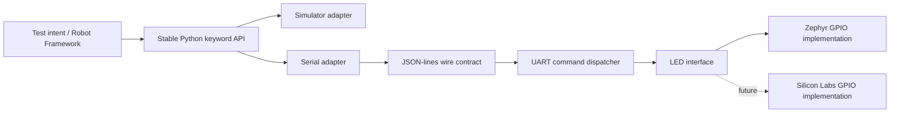
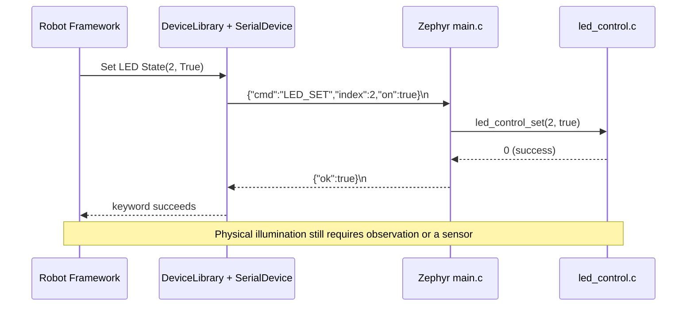

# Architecture and design decisions

## Separation of concerns

**Test intent** belongs in `.robot` files. **Transport** belongs in `serial_adapter.py`. **Protocol dispatch** belongs in `main.c`. **Hardware GPIO** belongs in `led_control.c`. This prevents a new board from forcing rewrites of every test.

## Important historical engineering fixes

1. **UART lost characters**: sleeping 1 ms between `uart_poll_in` attempts caused truncated JSON at 115200 baud. The working experiment removed `k_msleep(1)` and used continuous polling. The refactor retains this behavior, with an explicit TODO to move to interrupt-driven reception.
2. **LED_GET mismatch**: reading the GPIO output through `gpio_pin_get_dt` did not match the intended logical state in the earlier experiment. The refactor records last successfully commanded state in the LED module. It is *not* an independent measurement of the pin.
3. **Serial vs simulator truth**: simulated BLE is a test double. Firmware advertises only `gpio`, so BLE tests skip on the real board.
4. **Board identity safety**: the Python serial connection checks firmware-reported `board` before executing tests, reducing the risk of testing the wrong kit.

## Protocol request lifecycle

## What changes per board?

| Layer | Nordic nRF52840 DK | Nordic nRF54L15 DK (future) | Silicon Labs BG22 (future) |
| --- | --- | --- | --- |
| Robot keywords | Reuse | Reuse | Reuse |
| Serial adapter | Reuse | Reuse if UART protocol is implemented | Reuse if UART protocol is implemented |
| Protocol commands | Reuse | Reuse | Reuse |
| LED GPIO | Zephyr devicetree aliases | Zephyr aliases, verify board | Vendor SDK GPIO or Zephyr |
| Capabilities | `gpio`, LED count | Report actual implemented features | Report actual implemented features |
| Build/flash | nRF Connect SDK | nRF Connect SDK, board-specific build | Silicon Labs tools |

**Current capability contract:** `{"led_count":N,"features":["gpio"]}`. A richer schema is planned but not introduced here to avoid breaking the working Python keywords.
