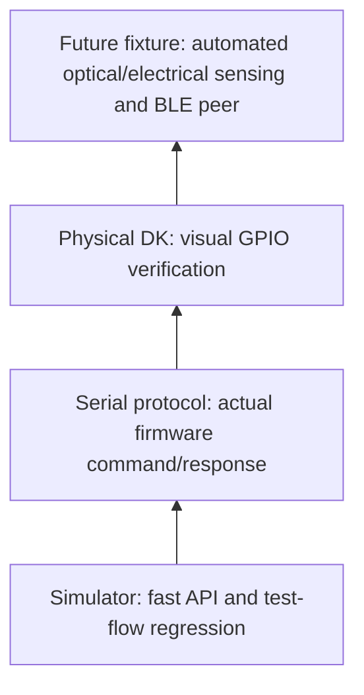

# Testing strategy and evidence

## Test pyramid

| Phase | Command / action | Pass criterion |
| --- | --- | --- |
| A | `python -m robot --outputdir results/simulator tests/common/ tests/optional/` | 6 PASS, 2 SKIP, 0 FAIL |
| B | Build/flash `firmware/nordic_zephyr/` | Build succeeds; serial `IDENTITY` reports correct board |
| C | `tests/platform/01_nrf52840_hardware.robot` with serial backend | 2 PASS and each advertised LED visibly cycles |
| D | `tests/common/` with serial backend | Boot/GPIO PASS; BLE SKIP until firmware implementation |
| E | Later nRF54L15 DK | Independent build and real hardware evidence required |

**Verified Phase 1 evidence (10 November 2026):** the refactored nRF52840 firmware built and flashed, UART returned firmware `hil-serial-v2` with `led_count=4`, and the hardware suite passed **2/2 tests**. The operator confirmed LED1–LED4 physically switched on/off. The one-command combined runner is new and must still be tested separately.

## PASS, SKIP, FAIL semantics

- **PASS:** observed result meets an assertion.
- **SKIP:** firmware does not advertise the feature, or external fixture is absent.
- **FAIL:** advertised behavior is broken, communication fails, or identity mismatches.

## Evidence caution

`LED_GET` returns the last commanded software state. It does not prove electrical pin voltage or light output. Add a camera, photodiode, or GPIO measurement fixture for unattended physical verification.

## Single-command evidence collection

Run `python scripts/run_validation.py --port COM3` from the repository root
with the compatible firmware already flashed. Review `results/phase1/log.html`,
`report.html`, and `validation_summary.json`. The expected combined counts are
**10 total / 8 PASS / 0 FAIL / 2 SKIP**. Hardware preflight failure means a
simulator-only HTML log may still be generated: consult the JSON stage results.

During hardware testing, watch LED1, LED2, LED3, and LED4 turn ON individually
for about two seconds and OFF again. The log records commands and asserted
software state, not actual optical emission. To record the human observation
in the summary JSON, use `--led-observation confirmed` only after witnessing
the full sequence during that run. No fixture-based light sensing is included.

## Advanced flow-control extension (not yet verified)

The new `tests/simulator/05_advanced_flow.robot` suite adds six simulator
checks for IF/ELSE, TRY/EXCEPT/ELSE, FOR, and negative behavior. The runner
now includes it. **Expected** totals: 14 simulator cases (12 PASS, 2 SKIP)
and 16 combined cases (14 PASS, 2 SKIP). These are projections, not the
previously verified results. See [advanced Robot Framework](advanced_robot_framework.md).
